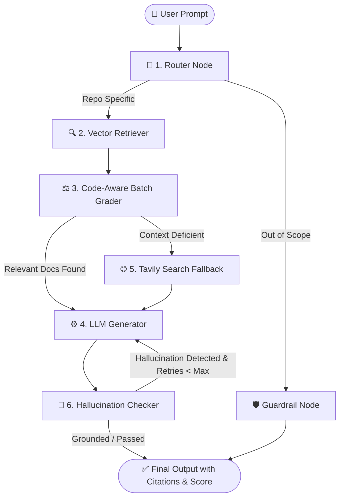

<div align="center">

# 🚀 RepoPilot
### Production-Grade Autonomous Codebase Intelligence & Agentic RAG

[](https://python.org)
[](https://fastapi.tiangolo.com)
[](https://nextjs.org)
[](https://langchain-ai.github.io/langgraph/)
[](https://groq.com)
[](https://trychroma.com)
[](https://docker.com)
[-brightgreen?style=for-the-badge&logo=pytest&logoColor=white)](https://docs.pytest.org)

<p align="center">
  <b>RepoPilot</b> is an autonomous, agentic RAG system that ingests any GitHub repository, builds a comprehensive architectural and code-level index, and provides deep contextual answers with verified citations, confidence metrics, and self-correcting hallucination detection.
</p>

</div>

---

## 🌟 Key Highlights & Engineering Innovations

- 🧠 **Cyclic State Machine (LangGraph)**: Multi-node agentic workflow featuring query classification, batch document grading, dynamic web search fallbacks, and automated hallucination self-correction loops.
- ⚡ **Ultra-Fast LLM Inference (~300ms)**: Integrated with Groq's LPU engine running `llama-3.3-70b-versatile` for near-instant technical synthesis.
- 🔍 **Code-Aware Hierarchical Ingestion**: Clones Git repositories, profiles full tree hierarchies (`_REPO_ARCHITECTURE.md`), and splits code along structural boundaries (Python, TypeScript, Markdown, configs) with rich source and line metadata.
- 🛡️ **Grounded Hallucination Guardrails**: Evaluates generated answers against source vectors; automatically re-prompts if any claims lack supporting context.
- 📊 **Real-Time System Diagnostics**: Live health status monitoring for API keys, vector store chunk counts, and model latencies with a pulsing UI indicator.
- 🎨 **Glassmorphic Monochromatic UI**: Modern Next.js interface with dark mode, markdown code rendering, file citation badges, and interactive status modal.

---

## 🏗️ System Architecture & Workflow



---

## 📁 Repository Structure

```text
RepoPilot/
├── backend/
│   ├── app/
│   │   ├── agent/                 # LangGraph Agent Core
│   │   │   ├── nodes/             # Router, Retriever, Grader, Generator, Checker
│   │   │   ├── graph.py           # Compiled StateGraph workflow
│   │   │   ├── state.py           # TypedDict GraphState definition
│   │   │   ├── edges.py           # Conditional routing logic
│   │   │   └── llm.py             # Resilient LLM factory & SSL handling
│   │   ├── ingest/                # Repository Ingestion Engine
│   │   │   ├── loader.py          # Git cloner & AST architecture profiler
│   │   │   ├── chunker.py         # Code-aware recursive text splitter
│   │   │   └── embedder.py        # ChromaDB vector store & local embeddings
│   │   ├── api.py                 # FastAPI server & endpoints
│   │   └── config.py              # Centralized environment settings
│   ├── tests/                     # Pytest suite (agent routing, API, chunker)
│   ├── requirements.txt           # Python dependencies
│   └── Dockerfile                 # Backend container definition
│
├── frontend/
│   ├── src/
│   │   ├── app/                   # Next.js 16 App Router
│   │   └── components/            # Sidebar, Chat, ApiStatusModal
│   ├── package.json               # Frontend dependencies
│   └── Dockerfile                 # Frontend container definition
│
├── docker-compose.yml             # Full-stack Docker orchestration
├── .env.example                   # Environment configuration template
└── README.md                      # Documentation
```

---

## 🚀 Quickstart Guide

### Option A: One-Click Docker Compose (Recommended)

```bash
# 1. Clone repository
git clone https://github.com/your-username/RepoPilot.git
cd RepoPilot

# 2. Configure environment
cp .env.example .env
# Edit .env with your GROQ_API_KEY and TAVILY_API_KEY

# 3. Launch full stack
docker compose up --build
```
Open **`http://localhost:3000`** in your browser.

---

### Option B: Local Manual Setup

#### 1. Backend (FastAPI)
```bash
cd backend
python3 -m venv venv
source venv/bin/activate
pip install -r requirements.txt

# Start backend server
uvicorn app.api:app --host 0.0.0.0 --port 8000 --reload
```

#### 2. Frontend (Next.js)
```bash
cd frontend
npm install
npm run dev -- -p 3000
```

---

## 🧪 Running Automated Tests

```bash
cd backend
source venv/bin/activate
pytest -v
```

---

## 🔌 API Reference

| Endpoint | Method | Description |
| :--- | :---: | :--- |
| `/health` | `GET` | Basic backend health check |
| `/api/status` | `GET` | Live latency & connectivity diagnostic for Groq, Chroma, and Tavily |
| `/ask` | `POST` | Execute agentic workflow and return structured answer with citations |
| `/ask/stream` | `POST` | Real-time Server-Sent Events (SSE) token and step streaming |
| `/ingest` | `POST` | Clone, profile, chunk, and index a GitHub repository URL into ChromaDB |

---

## 📄 License
MIT License. Built with ❤️ for developers and AI engineers.
